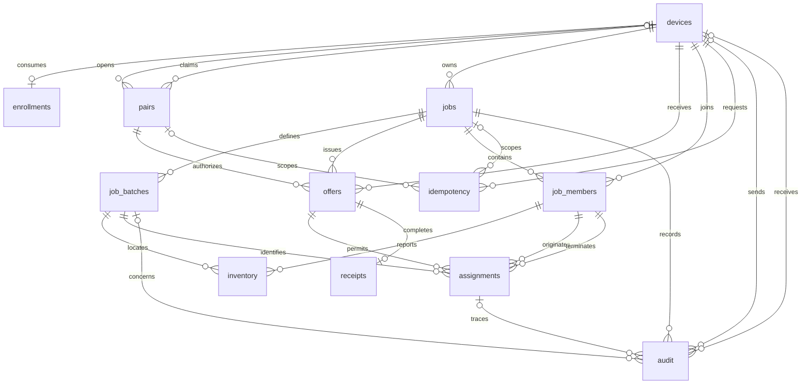
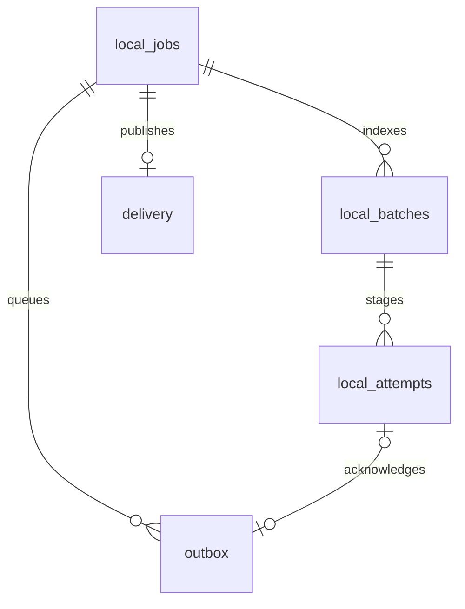

# Lược đồ SQLite của Ratatoss

Áp dụng [controller.sql](controller.sql) cho controller và [node.sql](node.sql) cho từng Node. Hai tệp khởi tạo DB trống bằng SQLite 3.38 trở lên có hàm JSON. Mỗi connection bật `foreign_keys`, `synchronous=FULL` và `busy_timeout` trước giao dịch. Mức chờ khóa khởi điểm trong DDL là 5 giây. Xác nhận `journal_mode=wal` trên DB chạy bằng tệp. DB `:memory:` dùng `journal_mode=memory`. Chạy `python validate.py` bằng Python 3.11 trở lên trong thư mục này để kiểm tra hai lược đồ bằng DB trong bộ nhớ.

`*_id` là UUID dạng `TEXT`, trừ `batch_id` là chỉ số từ 0 và các ID hàng `event_id` thuộc nội bộ DB. `*_at_ms` và `expires_at_ms` là mili giây UTC kể từ Unix epoch. `*_sha256` lưu 32 byte `BLOB`, chuyển sang hex thường khi đi qua API. `manifest_canonical` lưu nguyên byte UTF-8 theo [quy tắc manifest](../../docs/storage-and-recovery.md). Ứng dụng xác thực UUID, JSON theo schema giao thức, SHA-256, giới hạn kích thước, offset và tính bất biến của manifest trước khi ghi. Deadline để giới hạn tiến trình tại Node được tính trên đồng hồ monotonic từ thời gian còn lại do controller trả về.

## Controller

| Bảng | Khóa và dữ liệu |
|---|---|
| `devices` | PK `device_id`. Tên, hash token, thời điểm ghi danh/thu hồi, `boot_id`, heartbeat cuối, `connection_epoch`, số slot RX/TX rảnh được báo. |
| `enrollments` | PK `code_sha256`. Mốc phát/hết hạn/tiêu thụ. FK `device_id` chỉ có sau khi dùng mã, duy nhất theo thiết bị. |
| `pairs` | PK `pair_id`. FK thiết bị mở phiên và thiết bị claim. Hash mã ghép, mã đối chiếu sáu chữ số, hai mốc xác nhận, TTL, trạng thái. Cột sinh `device_low` và `device_high` chuẩn hóa cặp. Partial index giới hạn một cặp `ACTIVE`. |
| `jobs` | PK `job_id`, FK thiết bị nguồn. Manifest canonical, digest manifest, hash và kích thước toàn file, trạng thái, thời điểm tạo/đóng. |
| `job_batches` | PK `(job_id, batch_id)`. Offset duy nhất trong job, kích thước và hash batch. Tạo cùng job từ manifest đã kiểm tra. File rỗng có tập hàng rỗng. |
| `offers` | PK `offer_id`, FK job/đích/cặp ghép lúc tạo. Duy nhất `(job_id, target_device_id)`. Hạn quyết định, mốc chấp thuận, quyền forward, trạng thái consent. |
| `job_members` | PK `(job_id, device_id)`. Có hàng cho nguồn và từng đích được chọn. `reconciled_epoch` đánh dấu lần kết nối đã đối chiếu cho job. Quyền thực tế dựa trên vai trò nguồn hoặc trạng thái `offers`. |
| `inventory` | PK `(job_id, device_id, batch_id)`. FK thành viên và batch cùng job. Có hàng nghĩa là batch đã được báo xác minh. Trước khi giao việc phải kiểm tra thêm session và quyền hiện hành. |
| `assignments` | PK `assignment_id`. FK batch, thành viên ở cả hai đầu và offer đích cùng job. Hai epoch của phiên, relay profile, thời điểm tạo/hết hạn/đóng, trạng thái và `ack_processed_at_ms`. Partial index giới hạn một lease sống theo `(job_id, target_device_id, batch_id)`. |
| `receipts` | PK `(job_id, target_device_id)`, FK offer. Ghi thời điểm controller xác nhận file cuối. Hash và kích thước có sẵn trong job bất biến mà request đã đối chiếu. |
| `idempotency` | PK `(device_id, method, route, request_key)`. Hash payload, trạng thái HTTP và JSON kết quả đã lọc. FK phạm vi job hoặc pair khi có. |
| `audit` | PK `event_id`. FK job, batch, hai thiết bị và assignment khi tương ứng. Chỉ ghi mã kết quả và thời điểm cùng định danh cần thiết. |

### Giao dịch và vòng đời controller

1. Dùng `BEGIN IMMEDIATE` cho thay đổi quyền, tạo/hết hạn/ACK lease, receipt và thay thế inventory. Chụp `now_ms` sau khi lấy khóa, so với TTL bằng `now_ms < expires_at_ms`. Trả kết quả có hiệu ứng và kích hoạt scheduler sau commit. Xác thực token trước tra cứu kết quả lặp. So digest payload trên khóa `(device_id, method, route, request_key)`, trong đó route gồm ID tài nguyên thực tế. Khác digest trả `409`, trùng thì trả kết quả cũ theo quyền truy cập hiện hành. Ghi mutation và bản ghi idempotency trong cùng giao dịch.
2. Tiêu thụ enrollment và tạo `devices` trong cùng giao dịch. Dùng điều kiện mã chưa tiêu thụ và còn TTL. Nếu mất phản hồi sau commit, thu hồi thiết bị mồ côi và cấp mã ghi danh mới theo giao thức. Pair đi từ `OPEN` đến `CLAIMED`, sau đó đến `ACTIVE` khi đủ hai xác nhận. `OPEN` hoặc `CLAIMED` có thể hết hạn, `CLAIMED` có thể bị từ chối, `ACTIVE` có thể bị thu hồi. Claim và xác nhận đều kiểm tra hai thành viên, trạng thái và TTL khi ghi. `REVOKED` thu hồi offer đang chờ của pair và quyền tạo offer mới. Consent đã chấp nhận có vòng đời riêng.
3. Tạo `jobs`, `job_batches`, `job_members` và toàn bộ `offers` cùng commit. Kiểm tra nguồn và đích khác nhau, từng pair `ACTIVE` chứa đúng hai thiết bị và danh sách không trùng. Offer `PENDING` chuyển `ACCEPTED`, `DECLINED`, `EXPIRED` hoặc `REVOKED`. Chỉ đích được quyết định, `ACCEPT` kiểm tra digest và TTL. `ACCEPTED` chuyển `WITHDRAWN`, `VERIFIED` hoặc `CANCELED`. Khi rút consent, hủy lease RX/TX đang sống của đích trong job trong cùng giao dịch. Khi nguồn dừng, đóng job `CANCELED`, thu hồi offer đang chờ, chuyển đích đang nhận sang `CANCELED` và hủy lease còn sống, giữ receipt đã ghi. Khi mọi offer đã kết thúc, kết quả tự nhiên là `COMPLETE`, `PARTIAL` hoặc `NO_DELIVERY` theo số receipt. Đích `VERIFIED` có thể tiếp tục TX trong job còn mở với `allow_forward = 1`.
4. Tăng `devices.connection_epoch` khi boot đổi, kết nối lại sau timeout, hoặc controller cần đánh giá lại session sau khởi động. Vô hiệu hóa lease cũ, cách ly thiết bị chưa có heartbeat hiện hành. Chỉ giao việc khi `job_members.reconciled_epoch` khớp epoch hiện tại ở cả hai đầu. Reconcile xác thực `boot_id` hiện hành, quyền nguồn hoặc đích được phép, toàn bộ chỉ số batch, rồi thay chính xác tập `inventory` của một thành viên và cập nhật epoch trong cùng giao dịch. Hủy TX còn sống nếu batch của nguồn bị bỏ khỏi inventory. Heartbeat chỉ báo liveness và slot. Số slot dùng được còn phải trừ slot đã dự trữ mà heartbeat chưa phản ánh.
5. Khi tạo assignment, kiểm tra job mở, đích `ACCEPTED` còn thiếu batch, nguồn có inventory và quyền TX, cả hai online/đã reconcile, slot và hạn. Chuyển lease hết hạn sang `EXPIRED` với `closed_at_ms` trước khi chèn ID mới. `ready` chỉ từ đúng đích với lease `OFFERED` còn hạn, cập nhật `RUNNING` cùng hạn mới. `RUNNING` kết thúc bằng `ACKED`, `FAILED`, `EXPIRED` hoặc `CANCELED`. `OFFERED` có thể `FAILED`, `EXPIRED` hoặc `CANCELED`. `fail` kiểm tra người báo là một đầu và lần giao còn sống. `ready` lặp dùng lại mã trong lease còn sống, giữ hạn cũ.
6. ACK xác thực đúng đích, hash batch theo `job_batches`, và quyền còn hiệu lực. Dùng `ack_processed_at_ms` làm dấu đã xử lý theo assignment kể cả khi đổi request key. Xử lý lần đầu bằng cách cập nhật dấu và `INSERT ... ON CONFLICT DO NOTHING` vào `inventory`, ghi audit bổ sung batch nếu thực sự chèn. Chỉ chuyển chính assignment đang `RUNNING` còn hạn sang `ACKED`. ACK muộn hợp lệ vẫn có thể bổ sung batch trong epoch hiện hành. Khi ACK đến từ assignment thuộc epoch cũ, chấp nhận kết quả sau reconcile nếu ảnh chụp hiện hành đã chứa batch, tránh khôi phục batch mất sau đổi phiên. Scheduler có thể hủy lease thay thế theo quyết định riêng khi thấy batch đã có. ACK đã xử lý luôn trả kết quả cũ mà không thêm lại hàng inventory, kể cả khi reconcile vừa loại batch.
7. Receipt kiểm tra đúng đích, digest manifest, hash và kích thước file cùng đủ `job_batches` trong `inventory` đã reconcile. File rỗng thỏa kiểm tra đủ batch với tập rỗng. Trong cùng giao dịch, chèn `receipts`, chuyển offer `VERIFIED` và tính lại trạng thái job. Receipt lặp hợp lệ trả bản ghi cũ kể cả khi offer đã `VERIFIED` hoặc job đã đóng. Dùng `verified_at_ms` để hiển thị mốc xác minh theo từng đích.

Token và mã thô không nằm trong DB hoặc audit. `result_json` chỉ giữ dữ liệu an toàn để dựng lại phản hồi. Với `ready`, giữ mã Croc theo assignment trong bộ nhớ đến hết lease. Vô hiệu hóa lease nếu controller mất mã khi restart. Với mở pair, có thể dựng lại cùng mã 128 bit bằng PRF trên `pair_id` và khóa ngoài DB giữ ổn định qua restart, chỉ lưu hash mã vào `pairs`. Mã sáu chữ số để người dùng đối chiếu khác với mã dùng để claim. Chỉ hiển thị mã đối chiếu trong phiên cho hai thiết bị tham gia qua API đã xác thực. Dọn dữ liệu theo vòng đời và thứ tự FK, giữ idempotency trong thời gian job hoặc pair còn tồn tại.

## Node

Khi snapshot nguồn tạm thời không đọc được, kho loại các batch của snapshot khỏi inventory đến lần đối chiếu đọc và xác minh lại thành công. Nếu file đích tạm thời không đọc được khi mở kho, receipt đang chờ được giữ nguyên trong SQLite và tạm ẩn khỏi hàng gửi. `reconcile()` hoặc `publish_delivery()` kiểm lại file đích trước khi khôi phục việc gửi receipt.

| Bảng | Khóa và dữ liệu |
|---|---|
| `local_jobs` | PK `job_id`, nguồn và vai trò `SOURCE`/`TARGET`. Đích lưu `offer_id`, consent, khóa yêu cầu consent hiện hành và quyền forward. Manifest canonical, digest, root riêng của job, đường dẫn snapshot bất biến của nguồn, thời điểm tạo/đóng. |
| `local_batches` | PK `(job_id, batch_id)`, FK job. `MISSING`, `CORRUPT` hoặc `AVAILABLE`, vị trí lưu và mốc cập nhật. Nguồn có thể trỏ vào snapshot và lấy offset từ manifest. Đích trỏ vào file batch đã publish. Batch tạm thời không đọc được có thể giữ đường dẫn ở trạng thái `MISSING` để đối chiếu lại. Chỉ batch `AVAILABLE` được đưa vào inventory. |
| `local_attempts` | PK `assignment_id`, FK batch, boot ID, vai trò `TX`/`RX`, đường dẫn staging, vòng đời và các mốc tạo/đóng. Hàng batch `MISSING` có thể tồn tại trước khi tạo RX. |
| `delivery` | PK và FK `job_id`. Đường dẫn đích dự kiến, trạng thái publish và mốc công bố bền vững. |
| `outbox` | PK `event_id` tăng dần, `request_key` duy nhất. FK job, FK bộ `(assignment_id, job_id, batch_id)` cho ACK, boot ID trong payload reconcile, JSON request, `first_sent_at_ms`, boot gửi gần nhất `sent_boot_id` và dữ liệu retry. Có tối đa một receipt đang chờ mỗi job và một ACK đang chờ mỗi assignment. |

### Giao dịch và phục hồi Node

1. Node tạo `boot_id` mỗi lần chạy. Token đi vào kho bí mật hệ điều hành hoặc tệp ACL riêng. Đích commit `local_jobs.consent='ACCEPT'`, `allow_forward` và `delivery` ở `PLANNED` trong một giao dịch trước khi gọi API accept. Giữ khóa yêu cầu khi gửi lại. Chặn RX/TX cho tới khi nhận được phân công hợp lệ và hoàn tất đối chiếu. Vị trí thư mục riêng, snapshot và staging lấy từ định danh đã kiểm tra. Tên hiển thị chỉ dùng cho UI hoặc đề xuất tên file đích.
2. RX đi qua `ASSIGNED`, `TRANSFERRING`, `RECEIVED`, `VERIFIED`, rồi `FINISHED`, hoặc terminal `FAILED`/`CANCELED`. Chỉ bắt đầu kiểm file sau khi tiến trình truyền đã dừng. Kiểm file thường, kích thước, hash batch và từng piece. Dưới khóa `(job_id, batch_id)`, tái sử dụng bản hợp lệ hoặc flush rồi publish bền vững vào kho. Sau đó commit `local_batches.state='AVAILABLE'`, trạng thái attempt và ACK outbox cùng giao dịch. TX yêu cầu file snapshot hoặc batch AVAILABLE và giữ reference cho tới khi worker kết thúc. Khi batch hỏng, dừng TX, hạ trạng thái và xóa ACK chờ cho batch trong một giao dịch, rồi gửi reconcile sửa inventory.
3. Ghi `delivery` ở `PUBLISHING` với đường dẫn dự kiến trước khi publish. Lắp file vào tệp tạm cùng volume đích, kiểm kích thước và SHA-256 toàn file, flush và publish nguyên tử không ghi đè. `PATH_CONFLICT` giữ batch để người dùng chọn đích khác. Khi file đã publish bền, commit `PUBLISHED` cùng outbox `RECEIPT`. Xác nhận inventory đầy đủ qua ACK/reconcile trước khi gửi receipt.
4. Khi startup, dừng tiến trình còn sót rồi dọn staging cũ. Quét kho theo manifest trước khi quảng bá availability. Nhận lại file đã publish mà thiếu hàng DB sau khi kiểm hash. Hạ `AVAILABLE` nếu file thiếu/hỏng và xóa ACK chờ tương ứng. Đọc lại file đích và kiểm hash để khôi phục delivery/receipt sau crash giữa publish và commit. Giữ file đích hợp lệ trong quyền quản lý của người dùng.
5. Mỗi job dùng một luồng phát outbox với tối đa một mutation đang chờ kết quả. Ghi `first_sent_at_ms` trước lần gọi mạng đầu tiên. Trong cùng epoch, xử lý yêu cầu đang dở bằng cùng request key trước khi gửi snapshot thay thế, để request cũ đã commit chỉ được replay kết quả. Qua boot mới, bỏ snapshot cũ, controller từ chối snapshot có boot khác. Khi reconnect cùng boot, nếu còn reconcile chưa rõ kết quả, xác nhận kết quả theo khóa cũ trước rồi gửi snapshot mới. Sau kiểm đĩa, hoàn tất snapshot đầy đủ trước khi phát lại ACK/receipt còn hợp lệ. Phát ACK theo `event_id` và chỉ phát receipt khi inventory đủ. Đợi hết backoff của ACK đầu hàng. Retry giữ nguyên key và JSON, cập nhật `attempt_count`/`next_attempt_at_ms`. Sau phản hồi thành công, xóa hàng tương ứng trong giao dịch ngắn. Loại ACK chưa gửi của batch bị hạ, hoàn tất xử lý ACK đã gửi với cùng key trước khi gửi snapshot sửa mới trong cùng epoch, và giữ TX bị chặn trong lúc chờ.
6. Giữ snapshot nguồn và batch còn đủ điều kiện chuyển tiếp cho đến khi job đóng hoặc người dùng chủ động bỏ dữ liệu. Dọn sau khi xử lý xong outbox và hết worker reference. Tất cả giao dịch DB giữ ngắn. Croc, mạng, hash, ghi và flush file diễn ra ngoài transaction SQLite.

Agent gọi `NodeStore.mark_event_sent(job_id, request_key)` trước khi gửi sự kiện đầu hàng. Kho ghi `sent_boot_id` theo phiên gửi hiện tại và giữ `first_sent_at_ms` của lần gửi đầu tiên. Nếu kho trả `OUTBOX_HEAD_CHANGED`, agent đọc lại hàng đợi trước khi gửi. Cột `sent_boot_id` được thêm khi mở cơ sở dữ liệu Node phiên bản 1 và giữ nguyên dữ liệu request cũ.
