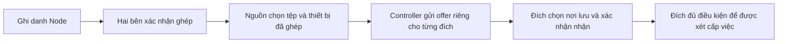
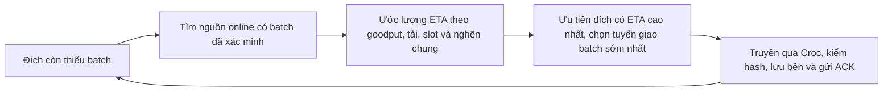
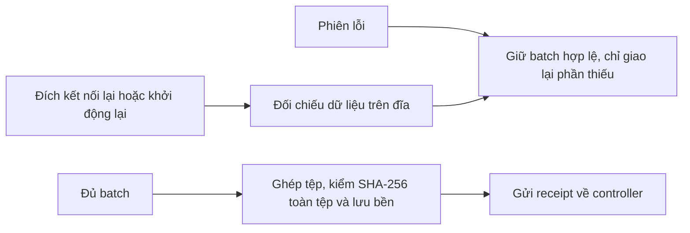

# Luồng hoạt động Ratatoss

[Mở sơ đồ minh họa dạng PDF](../output/pdf/Ratatoss-so-do-luong-hoat-dong.pdf)

**Phạm vi:** Một bản chính thức có PLARS. [Phạm vi phát hành và phần mở rộng](governance/adr/0001-single-release.md)

**Hiện trạng:** Bản hiện tại có CLI tạo và kiểm tra manifest SHA-256 cùng giao diện loopback chỉ đọc. [Mã và cách chạy](../README.md)

## 1. Ghép thiết bị và gửi lời mời

Quyền chuyển tiếp được bật riêng cho từng lượt gửi và mặc định tắt. [Ghi danh và ghép cặp · Job và consent](../docs/control-protocol.md)

## 2. Chọn tuyến và truyền batch

Sau ACK, B có thể chuyển batch vừa xác minh cho C trong khi vẫn nhận batch khác từ A. Lịch chia chẵn/lẻ dùng làm đối chứng benchmark. [PLARS cơ bản](../plan/ASTRA_PLAN.md#plars-cơ-bản)

## 3. Phục hồi và hoàn tất

Makespan tính từ lệnh chạy sau consent đến khi controller nhận receipt xác minh của đích cuối cùng. [Khởi động lại và mất kết nối](../docs/storage-and-recovery.md#khởi-động-lại-và-mất-kết-nối) · [Thu thập và lưu bằng chứng](../docs/experiments.md#thu-thập-và-lưu-bằng-chứng)
