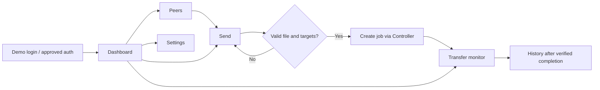

# RATATOSS — UI/UX Specification for Coding Agents

**Document ID:** `RAT-UI-SPEC-001`  
**Version:** `1.1.0` — 2026-11-18  
**Status:** UI prototype + implementation specification (not production-ready)  
**Product source of truth:** [`SOURCE_RATATOSS_BRIEF_v1.2.md`](./SOURCE_RATATOSS_BRIEF_v1.2.md)  
**Prototype:** `../index.html`, `../tokens.css`, `../styles.css`, `../app.js`  
**Language:** Vietnamese UI; English technical identifiers.  
**Priority hierarchy:** Product Brief > approved API contracts > UI_SPEC > prototype rendering > agent judgment.

> **NON-NEGOTIABLE:** The prototype simulates transfers; it is **not** a Croc client, job scheduler, peer discovery engine, security system or backend. Nothing visual is evidence that the protocol works. Only integrate supported events and endpoints with real data after backend capabilities have been verified.

## 1. Intended experience and design principles

Ratatoss distributes one file to multiple recipients via a Croc-based transport adapter with an orchestration layer. UX must serve two audiences: someone sending a file quickly, and someone observing a multi-peer delivery pipeline. The primary measure of success is **makespan** (when the **last recipient** has received **and verified** the file); do not optimize the UI around an attractive but misleading single-link speed.

Principles:
1. **Send in 3 steps:** pick a file → choose permitted peer recipients → review and start.
2. **Observe with confidence:** distinguish `bytes_received`, `batch_verified` and `file_verified`. `100% received` is not yet `complete` until full-file hash succeeds.
3. **Explanatory topology, not a fictional network:** annotate active/inactive/unmeasured links, connection type (LAN/WAN/relay/unknown), peer role and last event. Animations use actual scheduler assignments only in production.
4. **Pipeline is per verified batch:** a peer can TX a **verified and durable** batch while receiving a different batch. No byte-stream forwarding through Croc CLI is promised.
5. **No blanket replication:** spare-copy replication and SafeExit remain off by default and are explicitly flagged as later-phase features.
6. **Simulation transparency:** in UI-only mode, permanent DEMO marking and explicit `not measured` / `unavailable` states for goodput, ETA, hash, route selection and recovery.
7. **Minimize complexity:** primary navigation 6 items; use one accent, spacious cards, readable hierarchy, clear errors and accessible control labels.

## 2. Screens, routing and acceptance

| UI route (implementation recommendation) | Module | Purpose | Required elements | Release phase |
|---|---|---|---|---|
| `/login` | Demo login / real auth placeholder | Entry and identity | Guest/demo vs authenticated state; error/loading; no fake security claims | Backend-auth policy **not specified** by brief |
| `/dashboard` | Tổng quan | Current job summary | Active jobs, connected/known peers, recipient progress, verified outcomes, link to flow | MVP UI |
| `/peers` | Thiết bị | Discover/list & choose targets | Identity, online/offline, role, measured connection class, RX/TX capability, selection state | MVP UI; discovery implementation dependent |
| `/send` | Gửi tệp | Configure distribution | Single-file chooser, target list, allowed strategy, summary, validation & submit | MVP UI |
| `/transfers/:jobId` | Luồng truyền | Detailed job observability | Interactive node-edge graph, active assignments, per-recipient verified progress, events, errors/recovery | MVP UI for fixed pipeline, extend phase 2 |
| `/history` | Lịch sử | Past sessions and audit | Created/ended time, recipient verification, failed jobs, job IDs; filter/search if volume warrants | MVP UI, if persistence exists |
| `/settings` | Cài đặt | Appearance and resource budgets | Theme, language, session limits, bandwidth budgets, opt-in future features clearly disabled | MVP UI for display; policies per phase |

The **standalone prototype** is a single-page navigation shell with these route-equivalent modules. No router dependency is required to view it. If porting to Next.js, use real route segments, maintain equivalent navigation and deep links.

### 2.1 Login

The brief requires authenticated **Agent ↔ Controller** communication and authorization by job; it **does not define human sign-in**. The prototype supplies a local-name/email UX only. Coding agent must not claim this is authorization. Production needs decisions on human account system, session storage, CSRF, device pairing/invites and sender/recipient permissions. Until such requirements are approved, keep the screen `DEMO` or integrate a separately approved auth contract.

States: `idle`, `editing`, `submitting`, `authenticated`, `invalid-credentials`, `network-error`, `expired-session`, `guest-demo`. Password-based mock auth, permanent client secrets, hardcoded login, and fake OAuth flows are **forbidden**.

### 2.2 Peers

- **Source A** cannot be selected as the recipient of its own job.
- **B/C/D** are illustrative peer identities: B/C at one LAN site, D remote. Production may have other arbitrary peer counts and groups.
- Peer selection is limited to permissioned, reachable recipients. Presence is based on backend/Agent heartbeats; if stale show `unknown`, not `online`.
- Connection class may be `LAN_VERIFIED`, `WAN`, `RELAY`, `UNKNOWN`; **never** decide LAN from private IP, same subnet, SSID or device hostname alone.
- Peer capabilities, goodput, storage capacity, RX/TX session budgets, fault domain and permission should be available in details when supported.
- Search by name/device ID, multiselect, empty/no-result/offline/permission-denied handling.

### 2.3 Send

1. User selects one source file (matching current project scenario). Browser file picker metadata alone is **not** enough to enable Croc sending; backend will need an upload/staging or a local-Agent access approach.
2. Validate at least one authorized target and a source that the sender Agent can read. Don't send local absolute file paths to a remote Controller without an explicit approved design.
3. Select strategy: `FIXED_PIPELINE` (MVP research scenario), `DIRECT` / `GATEWAY` comparison baselines where **implemented**, `ADAPTIVE_PLARS` only from phase 2 after validated support. UI prototype strategy selector is **visual only**. Do not silently map labels to unsupported backend behaviors.
4. Show file info, recipient count, default spare-copy replication OFF, SafeExit OFF, batch sizing configured by backend, and an explicit start button.
5. On success use real `job_id` from backend and navigate to `/transfers/:jobId`. Show a pending state until server confirms acceptance; never synthesize a production `job_id`.

States: `no-file`, `file-chosen`, `no-recipients`, `valid`, `creating`, `started`, `failed`. On error, preserve form content.

### 2.4 Transfers / Node-flow view

Must support zoom/pan and keyboard-selectable peers/edges when there are many nodes. For 4-peer MVP, a fixed, responsive SVG layout is sufficient; for production adopt a robust layout engine only if actually needed.

**Node minimum fields:** stable peer ID; display name; source/recipient/forwarder role; status (`online`, `offline`, `unknown`); bytes received vs total; verified bytes / batches; `file_verified`; aggregate RX/TX goodput when **measured**; active job assignments and session limits; last heartbeat timestamp or `unknown`.

**Edge minimum fields:** `from_peer_id`, `to_peer_id`, type `LAN/WAN/RELAY/UNKNOWN`, direction, active assignment IDs, actual recent goodput (nullable), `measured_at`, state (`active`, `idle`, `failed`, `unknown`). Only animate edges with real active transfer evidence. A **candidate** or hypothetical route uses a distinct dashed style; it must not be drawn as active.

**Graph semantics:**
- A→B and A→C may overlap with B↔C and B/C→D; no full-file wait between receiving and forwarding.
- The B↔C LAN line should only display `LAN verified` if peer-to-peer connectivity was measured; otherwise use `LAN candidate`/`unknown`.
- A→D is conditional and **not automatically active**; direct can win on ETA.
- If C disconnects, mark C offline, change only its affected edges, keep verified progress intact, display recovery/reassignment as **pending until scheduler evidence arrives**.
- Show per-recipient state `transferring`, `verifying`, `verified`, `failed`, `reconnecting`; an aggregate job percentage is insufficient on its own.
- Highlight shared bottlenecks, especially B/C using one WAN branch, when Controller can represent them.
- Show event details without passwords, Croc codes, access tokens, absolute sensitive local paths or plaintext file contents.

**Main metrics:** `T_all / makespan (actual or estimated with clear label)`, max recipient ETA (nullable), completed verified recipients, verified bytes, source uploaded bytes, link/WAN bytes (only if instrumented), recovery overhead and optional replication overhead. Goodput is a measured moving-window throughput, not a nominal NIC speed. Unknown numbers must display `— / Chưa có dữ liệu` rather than 0.

**Actions:** Pause/resume/cancel only if backend supports authenticated, idempotent commands and defines consequences; prototype buttons merely affect its local timer. No stop/delete button with misleading backend semantics. A clicked node opens an inspector, not a made-up raw socket endpoint.

### 2.5 History

- Real job history comes from persisted Controller data; do not derive from temporary client-memory state after production integration.
- Label outcomes precisely: `COMPLETED_VERIFIED`, `PARTIAL`, `FAILED`, `CANCELLED`, `RUNNING`, `UNKNOWN`.
- If no backend history endpoint, show an honest empty/unavailable state.

### 2.6 Settings

Theme: light/dark, user-selectable; persist locally until account preference endpoint approved. Prototype stores only theme locally. The settings for RX/TX session count and bandwidth are not effective until Agent/Controller have confirmed constraints. Never claim settings have been applied solely because a selector changed.

SafeExit modes are **phase 3 only** and **OFF** by default:
- `DISABLED`: no source exit guarantee.
- `SOURCE_CAN_LEAVE`: ≥1 verified acknowledged durable copy **outside A** for every piece; no single-peer failure guarantee.
- `SOURCE_CAN_LEAVE_ONE_PEER_FAULT`: ≥2 copies on **independent peers** outside A for every piece, with fault-domain policy if required.

A visible SafeExit badge must be computed by backend evidence and show `NOT_READY / READY / UNKNOWN` with scope and version. Never infer READY from aggregate percentage. Auto spare-copy replication defaults OFF. Encryption across intermediate peers is unsupported until an approved **pre-piece payload encryption** design exists.

## 3. Information architecture and primary journeys



### 3.1 Empty / loading / error states

All data-driven modules need `loading`, `ready`, `empty`, `failed`, `stale`, `unauthorized`. If WebSocket drops, show `Đang kết nối lại / dữ liệu có thể cũ`, with last update, and do not continue animating graph as if telemetry were live. Network graph must be legible in reduced-motion mode and without animation. For incomplete status, no verified/completed toast.

## 4. Visual system

**UI source of truth for all exact values:** [`DESIGN_TOKENS.md`](./DESIGN_TOKENS.md), [`COMPONENT_DIMENSIONS.md`](./COMPONENT_DIMENSIONS.md) and the canonical `../tokens.css`. For page-by-page interaction/state/contract details see [`SCREEN_BLUEPRINTS.md`](./SCREEN_BLUEPRINTS.md). The following tables summarize the concept; tokens.css takes precedence when a shorthand differs. CSS values are UI proposals, not Product Brief requirements.

### 4.1 Colors

| Token | Dark | Light | Usage |
|---|---|---|---|
| `accent` | `#F47A28` | `#F47A28` | Primary CTA, focused flow, selected module |
| `accent-hover` | `#FF9D50` | `#FF9D50` | CTA hover |
| `background` | `#0E1014` | `#F6F5F2` | App canvas |
| `sidebar` | `#111318` | `#FBFAF8` | Main nav |
| `surface` | `#171A20` | `#FFFFFF` | Cards |
| `surface-raised` | `#1D2027` | `#F8F8F7` | Inputs / secondary containers |
| `text` | `#F5F5F3` | `#22242A` | Headings / body |
| `muted` | `#9399A6` | `#757A83` | Secondary text |
| `stroke` | `#2C3038` | `#E7E7E4` | Subtle borders |
| `success` | `#49C899` | `#49C899` | Verified / connected (with text) |
| `warning` | `#FFC679` | `#FFC679` | Warnings |
| `error` | `#EE7B75` | `#EE7B75` | Offline / failed (with text) |
| `LAN` | `#8BAEF9` | `#8BAEF9` | Distinct link type, never sole indicator |

### 4.2 Typography, space and shapes

- Reference fonts: `Manrope` for display, `DM Sans` for UI. In the offline build, system fallback works. Production: self-host fonts or use approved font delivery.
- Layout desktop **>1300px**: left sidebar `244px`, topbar `77px`, main content padding `34px 38px 60px`, max content `1640px`. At 1101–1300 sidebar is 220px; refer to COMPONENT_DIMENSIONS for all precise breakpoint overrides.
- Cards: radius `15px`; icon buttons `10px`; form fields `9px`; node `12px`; login modal `20px`. Avoid glossy/glassmorphism, neon, large gradients and decorative blobs.
- Spacing: 4px base; typical 8/12/16/20/24/32/40.
- Heading `clamp(24px,2.3vw,33px)`, display KPI `26px`, card title `14px`, body `13px` and labels `10–12px` **in prototype**. Production must raise small sizes and validate WCAG contrast. Production must audit tiny labels and increase where accessibility requires.
- Buttons: orange primary, surface secondary, subtle danger. Always present explicit textual action.
- Icons: consistent 1.7px outline SVG. Use `lucide-react` if moving to React; do not introduce a second competing icon family.

### 4.3 Responsive

| Width | Behavior |
|---|---|
| >1300px | 244px sidebar; 4 KPI columns; two-column graph + progress; two-column panels |
| 1101–1300px | 220px sidebar; denser spacing; retain 4 KPI columns |
| 851–1100px | 220px sidebar; KPIs in 2 columns; graph/progress stacked |
| 561–850px | 240px sidebar off-canvas; topbar 65px; keyboard- and touch-operable toggle |
| ≤560px | 2 KPI columns, single device column, compact node cards |

An implementation using real peer counts must not allow overlap/occlusion of peer labels; switch to layout/scroll/zoom rather than shrinking nodes below usability.

## 5. Interaction and motion

- Navigation: selected module gets pale orange background; pressed actions respond immediately without assuming backend success.
- Focus styles: visible 3px halo. Tab order follows reading order. Dialog traps focus in production and restores it to trigger on close (prototype uses a simplified dialog).
- Node selected: orange outline + inspector updates with that peer's data; keyboard operation mandatory.
- Active flow: moving dashed orange; LAN moving blue; inactive candidate dashed neutral; offline red and motion stopped. Do not animate on a telemetry timeout or a simulated state without a persistent DEMO marker.
- Progress: animate changes for numeric values, never invent an estimated ETA.
- Respect `prefers-reduced-motion`.
- File picker: drag/drop and click, accessible label, selected filename + size and removal; no fake upload spinner when backend not configured.
- Toast: status must reflect actual backend acknowledgement. Errors persist in context instead of disappearing as the only feedback.

## 6. UI data contracts — *proposed frontend view models*, not backend API truth

These are component-facing draft types. They must be mapped to the **approved API Contracts** later. No endpoint shape beyond those explicitly named in the product brief may be treated as guaranteed.

```ts
type PeerId = string;
type JobId = string;
type ISODateTime = string;
type LinkClass = 'LAN_VERIFIED' | 'WAN' | 'RELAY' | 'UNKNOWN';
type JobState = 'QUEUED' | 'RUNNING' | 'VERIFYING' | 'COMPLETED_VERIFIED'
  | 'PARTIAL' | 'PAUSED' | 'FAILED' | 'CANCELLED' | 'UNKNOWN';
type PeerPresence = 'ONLINE' | 'OFFLINE' | 'STALE' | 'UNKNOWN';
type BatchState = 'MISSING' | 'ASSIGNED' | 'TRANSFERRING' | 'RECEIVED'
  | 'VERIFIED' | 'AVAILABLE' | 'RETRY_PENDING' | 'CORRUPT';
type Strategy = 'FIXED_PIPELINE' | 'DIRECT' | 'GATEWAY' | 'ADAPTIVE_PLARS';

interface PeerView {
  id: PeerId; displayName: string; isSource: boolean;
  presence: PeerPresence; lastHeartbeatAt: ISODateTime | null;
  canReceiveJob: boolean; canForward: boolean;
  rxGoodputBps: number | null; txGoodputBps: number | null;
  maxRxSessions: number | null; maxTxSessions: number | null;
  linkClass: LinkClass; linkMeasuredAt: ISODateTime | null;
}
interface RecipientView {
  peerId: PeerId; totalBytes: number; receivedBytes: number;
  verifiedBytes: number; verifiedBatchCount: number;
  totalBatchCount: number; fileVerified: boolean;
  fileSha256VerifiedAt: ISODateTime | null;
  state: JobState; errorCode: string | null;
}
interface LinkView {
  from: PeerId; to: PeerId; linkClass: LinkClass;
  activeAssignmentIds: string[]; measuredGoodputBps: number | null;
  lastMeasuredAt: ISODateTime | null;
  state: 'ACTIVE' | 'IDLE' | 'FAILED' | 'UNKNOWN';
  sharedBottleneckGroupId: string | null;
}
interface JobView {
  id: JobId; fileName: string; totalBytes: number; sha256: string | null;
  state: JobState; strategy: Strategy; sourcePeerId: PeerId;
  recipients: RecipientView[]; links: LinkView[];
  makespanActualMs: number | null; makespanEstimatedMs: number | null;
  sourceUploadedPayloadBytes: number | null; wanBytes: number | null;
  startedAt: ISODateTime | null; completedAt: ISODateTime | null;
  lastTelemetryAt: ISODateTime | null;
}
```

**Rendering rules:** never divide by zero; clamp bars 0–100; use `totalBytes=0` as invalid/unknown unless backend supports empty file; `receivedBytes` must not be conflated with `verifiedBytes`. A job is completed only when **each** recipient has `fileVerified=true` with matching full-file manifest hash, subject to backend verification authority. `null` means unknown, not zero.

## 7. Backend integration boundaries

Brief §6 lists endpoint directions, not complete request/response contracts:

| Brief path | UI integration intent | Caveat |
|---|---|---|
| `POST /jobs` | Submit file/manifest and recipients | Exact schema and source file transport must be agreed; do not invent |
| `POST /peers/register` | Agent registration | Agent-side, not publicly exposed browser registration |
| `POST /peers/heartbeat` | Presence/resource telemetry | Agent-side, authenticated |
| `GET /peers/{id}/assignments` | Agent's assignment queue | Agent-side; not browser read API by default |
| `POST /assignments/{id}/ack` | Agent verification ACK | Only after durable + valid batch |
| `POST /assignments/{id}/fail` | Agent failure report | Agent-side; idempotency/retries defined server-side |
| `GET /jobs/{id}/status` | View job progress / verification | Return shape TBD; polling or WebSocket bridge if approved |

`GET /ui/peers`, `GET /jobs`, `WS /events`, and browser-side `POST /jobs/:id/pause` would be **new proposed endpoints**. They are *not* in the brief; do not build against them unless separately approved. Browser session auth is also unresolved.

Boundary: `UI → controller UI-facing adapter → FastAPI Controller → Scheduler → Agents → Croc transport adapter`. The UI **never** invokes the Croc CLI directly, never calculates the authoritative schedule and never declares verified batches based on a visual progress timer.

### Subscription/update behavior (when available)

- Accept **server** `job_id`, `peer_id`, assignment IDs, event timestamps and revisions.
- Bootstrap with `GET /jobs/{id}/status`; use an approved WebSocket stream only if available. On disconnect, show stale state, back off and reconcile from authoritative snapshot.
- Keep per-job event ordering/idempotency; duplicates must not advance client-derived progress. Avoid relying on arrival order across peers.
- Preserve last verified state during reconnect. Recalculate partial byte progress only from backend snapshots.
- Present stale/unauthorized/time-out cases clearly.

## 8. Source-bound invariants for agents

1. No verified/AVAILABLE batch may be forwarded until durable store and hash check succeed (brief §3 F1, F2).
2. No claim of streaming unverified in-flight bytes using Croc CLI. Pipeline is verified **batch-to-batch**.
3. No fixed 50/50 topology assumption; B/C may share a congested WAN. No automatic assertion that LAN works from address conventions.
4. No mandatory two-copy replication; **OFF by default**.
5. SafeExit **not MVP** and **OFF by default**. Never claim safe-to-exit from aggregate file progress.
6. D may receive directly from A or peers if schedule benefits makespan; no mandatory B→D.
7. Offline C does not reset B/D or validated C pieces; recovery reassigns **missing** batch tasks only.
8. All benchmarks require matched test conditions; never use mock values as evidence.
9. Croc is **hop-by-hop** encrypted, not sender-to-final-recipient end-to-end across intermediary peers.
10. Never expose peer auth secrets, Croc codes or session tokens in DOM, URL, logs or screenshots.
11. UI styles should not mutate the project brief or canonical design architecture documents.
12. Never silently invent backend fields, API endpoints, Scheduler strategies, security guarantees or Croc features.

## 9. Accessibility and QA acceptance

- Keyboard: all sidebar tabs, file picker, peer controls, graph nodes, modal submit/close accessible. Visible focus, dialog focus management.
- Accessibility: labeled forms, descriptive error messages, contrast WCAG AA where practical, not color-only states, status live regions and chart textual alternative; respect reduced motion.
- Layout: test 360, 390, 768, 1024, 1440, 1920px widths; dark & light; 1, 4, 20, 100 peers (larger cases need graph navigation, virtualization/zoom); overflow containment and no invisible actions.
- Data: 0-byte file, long UTF-8 filename, large (20 GB) file metadata, offline recipient, missing hash, 100% bytes with `fileVerified=false`, duplicate events, stale link measurements, disconnected Controller.
- API: unauthorized, forbidden, 409 conflicts, 422 validation, timeout, 5xx, reconnect, late ACK, idempotent ACK, job no longer exists, peer rejoining.
- Flow: source A→B and A→C; B RX and TX in parallel after verified batch; C offline then reconcile; never mark all complete until final SHA-256 check.
- Review: no benchmarks, goodput or timestamps forged on production screens.

## 10. MVP / future feature gates

| Feature | Phase 0 | Phase 1 MVP | Phase 2 | Phase 3 |
|---|---|---|---|---|
| Croc CLI transport proof | active | active | active | active |
| Batch-level verified pipeline | validation | supported | supported | supported |
| Recovery of missing verified pieces | validation | supported | supported | supported |
| Fixed LAN/WAN config & scheduler | validation | supported | supported | supported |
| Dynamic PLARS assignment and ETA strategy | — | disabled | active after validation | active |
| Auto Direct/Gateway/Swarm selection | — | disabled | conditional research | conditional |
| SafeExit + conditional spare replication | — | disabled | disabled | opt-in only |
| Pre-piece payload E2E encryption | — | disabled | disabled | optional research |

**Acceptance deliverable:** A user can select a file and real eligible peers through an approved UI-facing integration, start a batch pipeline job and inspect truthful recipient and network state; if integration is absent, the UI prominently declares demo and never fakes network execution.


## UI v1.2 — quyết định thiết kế đã chốt

- Dùng logo sóc cam do người dùng cung cấp từ `assets/ratatoss-logo-original.png`; bản UI tối ưu là `assets/ratatoss-logo.webp`. **Không tự vẽ lại logo, không thêm glow, không dùng logo cũ**.
- Flat visual system: không shadow/blur/neon/halo; nav trạng thái active dùng nền brand soft; node selected dùng 1px viền cam, focus keyboard có outline rõ.
- Sơ đồ topology vẫn phải giữ đúng trạng thái batch verified, peer online/offline; đường mô phỏng không được thành lời khẳng định về tuyến đo thực tế.
- Màn tổng quan chỉ gồm header và CTA, bốn KPI, graph, danh sách tiến độ người nhận. Không có hộp “nguyên tắc phân phối” lặp thông tin hoặc chú thích kỹ thuật dài.
- Màn khác: tiêu đề ngắn `Thiết bị`, `Gửi tệp`, `Luồng truyền`, `Lịch sử`, `Cài đặt`; tránh eyebrow song ngữ và giải thích nhắc lại. Cắt giảm microcopy nhưng không được giấu trạng thái lỗi, cảnh báo nguy hiểm, xác thực file hoặc quyền truy cập.
- Topbar có badge `DEMO` luôn hiển thị để không nhầm mock data với backend; không lặp banner cảnh báo trên mỗi màn.
- Bộ icon UI: outline 24×24, stroke `1.85`, round caps/joins, kích thước nav 19px, component 13–20px. Icon `Luồng truyền` dùng hình 2 node có liên kết, `Cài đặt` dùng bánh răng cân đối. Không trộn filled icon tùy tiện.
- Chỉ đổi UI và tài liệu UI, bảo toàn brief gốc / API/security/architecture hiện hữu; mode production không được dùng mock timer.
